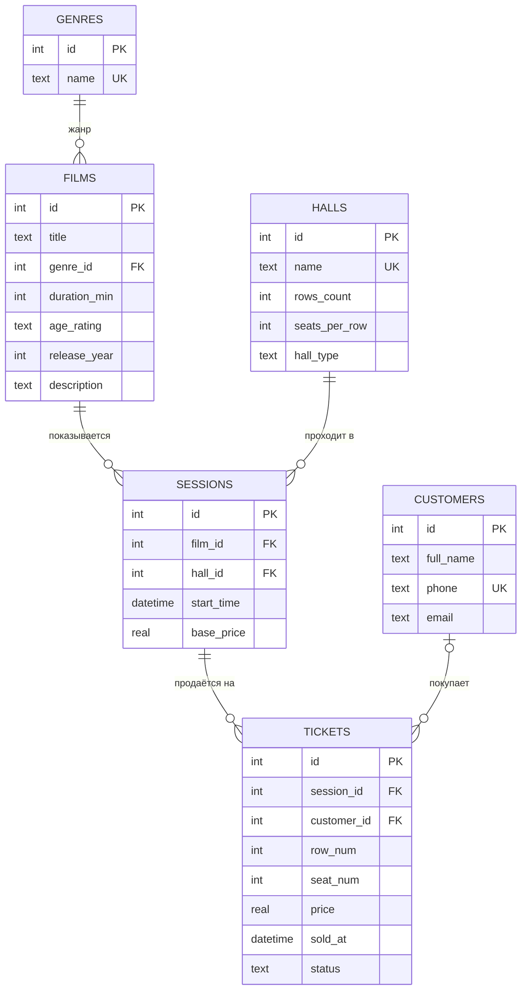
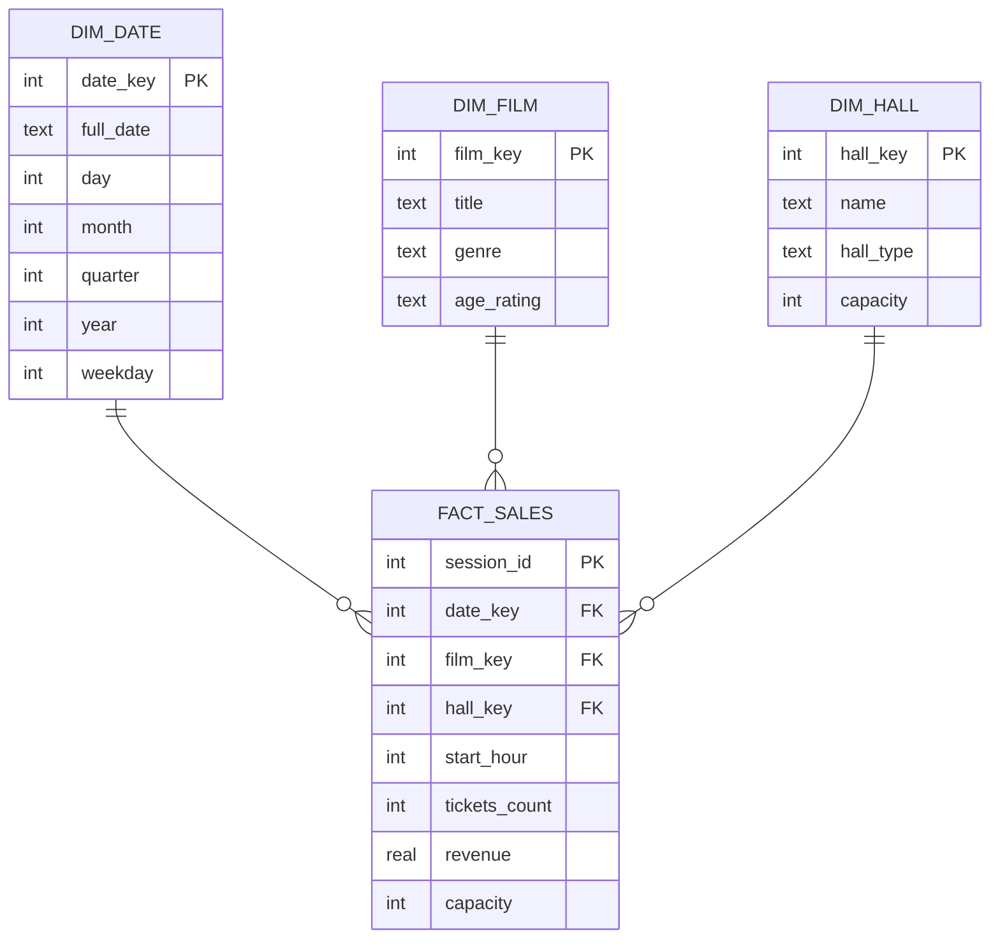

# Логическая модель базы данных «Кинотеатр»

## 1. ER-модель

Сущности предметной области и связи между ними:

| Сущность | Описание | Ключевые атрибуты |
|---|---|---|
| Жанр | Справочник жанров | название |
| Фильм | Фильм в прокате | название, год, длительность, возрастной рейтинг, описание |
| Зал | Зал кинотеатра | название, тип (2D/3D/IMAX), число рядов, мест в ряду |
| Сеанс | Показ фильма в зале в определённое время | время начала, базовая цена |
| Покупатель | Зарегистрированный зритель | ФИО, телефон, e-mail |
| Билет | Место на сеанс | ряд, место, цена, время продажи, статус |

Связи:

- Жанр 1 : N Фильм — у фильма ровно один жанр;
- Фильм 1 : N Сеанс — фильм показывается на многих сеансах;
- Зал 1 : N Сеанс — в зале проходит много сеансов (не пересекающихся по времени);
- Сеанс 1 : N Билет — на сеанс продаётся много билетов, место продаётся не более одного раза;
- Покупатель 1 : N Билет (необязательная) — билет может быть продан без регистрации покупателя.

Связь «Фильм — Зал» имеет тип M : N и разрешается через сущность «Сеанс».

## 2. Реляционная модель

Каждая сущность — отношение, связи 1 : N — внешние ключи на стороне «многие».

- **genres**(<u>id</u>, name UNIQUE)
- **films**(<u>id</u>, title, *genre_id* → genres, duration_min > 0, age_rating ∈ {0+, 6+, 12+, 16+, 18+}, release_year, description), UNIQUE(title, release_year)
- **halls**(<u>id</u>, name UNIQUE, rows_count 1..50, seats_per_row 1..60, hall_type ∈ {2D, 3D, IMAX})
- **sessions**(<u>id</u>, *film_id* → films, *hall_id* → halls, start_time, base_price ≥ 0)
- **customers**(<u>id</u>, full_name, phone UNIQUE, email)
- **tickets**(<u>id</u>, *session_id* → sessions ON DELETE CASCADE, *customer_id* → customers ON DELETE SET NULL, row_num, seat_num, price ≥ 0, sold_at, status ∈ {sold, refunded}); частичный уникальный индекс (session_id, row_num, seat_num) WHERE status = 'sold'
- **audit_log**(<u>id</u>, table_name, action, record_id, details, created_at) — журнал, который ведут триггеры

Схема находится в 3НФ: все неключевые атрибуты зависят только от первичного ключа; производные
величины (время окончания сеанса, вместимость зала, число проданных мест, выручка) не хранятся, а
вычисляются в представлениях `v_session_info` и `v_hall_stats`.

Ограничения, которые нельзя выразить декларативно, реализованы триггерами (`src/cinema/db/ddl.py`):
сеансы в одном зале не пересекаются; место билета существует в зале; цена билета по умолчанию
считается по тарифу зала; нельзя удалить будущий сеанс с проданными билетами; нельзя уменьшить
зал, если проданные места окажутся за его границами.

## 3. Хранилище данных (схема «звезда»)

Зерно факта — один сеанс. Иерархии измерений: Год → Квартал → Месяц → Дата; Жанр → Фильм;
Тип зала → Зал. Меры: выручка, число билетов, число сеансов, средняя цена, заполняемость.
